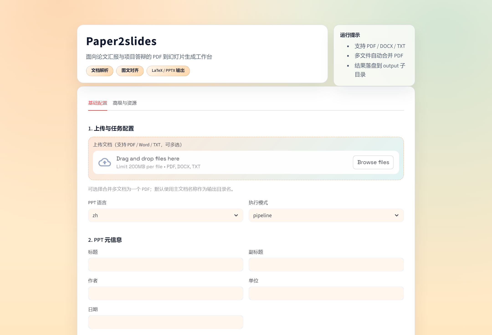

# Paper2slides

> Generate presentation-ready slides from research PDFs and related documents with LLM + RAG.

Paper2slides is a local workflow for turning papers, reports, and related source files into academic presentation decks. It parses PDF and document content, extracts figures and formulas, plans slide structure with an LLM, and exports both Beamer and native PPTX outputs.



## Features

- Parse PDF, DOCX, and TXT inputs
- Merge multiple source files into one workflow
- Extract text, figures, tables, and formulas from source documents
- Plan slide outlines and per-slide content with LLM assistance
- Export Beamer LaTeX, compiled PDF, PPTX, and optional slide preview images
- Support both CLI and Streamlit web UI
- Keep runtime logs, uploads, caches, and artifacts isolated under `runtime/`

## Typical Use Cases

- Paper presentation slides
- Thesis defense decks
- Research group report slides
- Project pitch and internal technical briefings

## Quick Start

### 1. Install dependencies

```bash
pip install -r requirements.txt
```

### 2. Configure model access

Create a `.env` file in the project root:

```env
APIYI_BASE_URL=your_openai_compatible_base_url
APIYI_API_KEY=your_api_key
LLM_MODEL=deepseek-chat
```

### 3. Start the web UI

```bash
streamlit run streamlit_app.py
```

### 4. Or run the CLI

```bash
python run_agent.py
```

## Runtime Layout

All run-time files are written under `runtime/`:

```text
runtime/
|- service/streamlit.log
`- runs/<project_slug>/<run_id>/
   |- uploads/
   |- cache/
   |- logs/
   |- artifacts/
   |- figures/
   |- figures_selected/
   `- slides/
```

Generated `.tex`, `.pdf`, `.pptx`, `.zip`, and `quality_report.json` are placed in `artifacts/`. Per-run logs live in `logs/run.log` and `logs/error.log`.

## Providing Figures

- Web UI: upload figures directly or upload a ZIP file in the figures section.
- CLI: pass an existing figures folder with `--figures /path/to/figures`.
- Large generated figure folders are no longer meant to stay in git; provide them at runtime instead.

## Outputs

Paper2slides can generate:

- `.tex` Beamer source
- `.pdf` compiled slide deck
- `.pptx` native PowerPoint file
- `.zip` packaged run outputs
- optional exported slide preview images
- `quality_report.json`

## Project Structure

```text
.
|- docs/
|- scripts/
|- streamlit_app.py
|- run_agent.py
|- ppt_agent/
|- tests/
|- template.pptx
`- runtime/
```

## Tech Stack

- Python
- Streamlit
- LangChain / LangGraph
- OpenAI-compatible APIs
- PyMuPDF / pdfplumber / pypdf
- python-pptx / python-docx / reportlab

## Status

The current repository already includes the core parsing, planning, export, and local UI workflow. It is suitable as a working local tool and can be extended further with custom templates, prompt strategies, and output styles.
